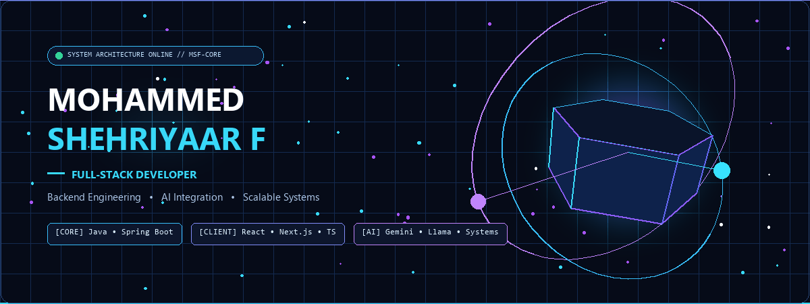
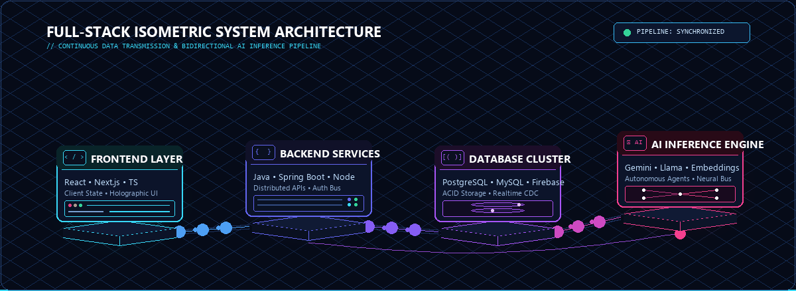
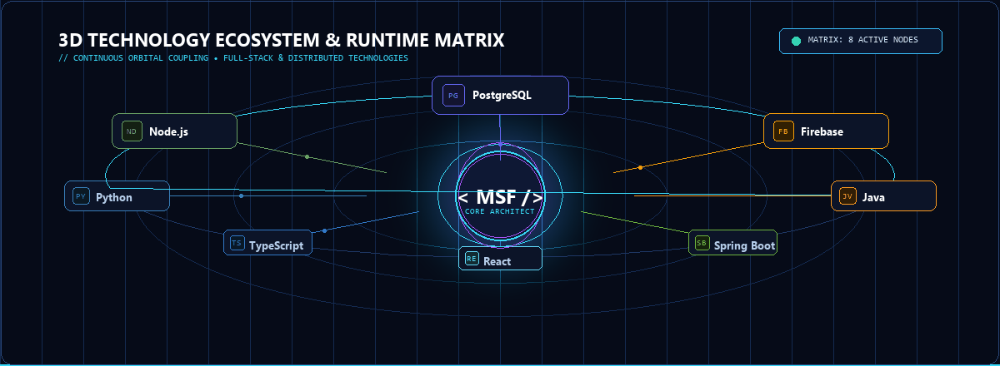

<!-- ==================================================================== -->
<!-- MOHAMMED SHEHRIYAAR F — CINEMATIC FULL-STACK PORTFOLIO              -->
<!-- Live Portfolio: https://shehriyaar-portfolio.vercel.app/             -->
<!-- ==================================================================== -->

  <!-- ==================== WEBSITE NAVIGATION ==================== -->
  

    <a href="#-about-me"><b>&nbsp; About &nbsp;</b></a> &bull;
    <a href="#-system-architecture"><b>&nbsp; Architecture &nbsp;</b></a> &bull;
    <a href="#-technology-ecosystem"><b>&nbsp; Tech Stack &nbsp;</b></a> &bull;
    <a href="#-flagship-projects"><b>&nbsp; Projects &nbsp;</b></a> &bull;
    <a href="#-experience--education"><b>&nbsp; Experience &nbsp;</b></a> &bull;
    <a href="#-connect--collaborate"><b>&nbsp; Contact &nbsp;</b></a>
  

  <!-- ==================== CINEMATIC 3D HERO ==================== -->
  

    

  <!-- Live Status & Call to Actions -->
  

    <code>🟢 SYSTEM STATUS: ACTIVE</code> &nbsp;&bull;&nbsp;
    <code>AVAILABLE FOR FULL-STACK &amp; BACKEND ROLES</code>
  

  

    
    &nbsp;
    
    &nbsp;
    
  

 

---

### ⚡ System Architecture

  

 

---

### 👨‍💻 About Me

I'm **Mohammed Shehriyaar F**, an **Information Science & Engineering** developer at **Vidyavardhaka College of Engineering, Mysuru**. I build modern, resilient full-stack web applications, scalable backend systems, and applied AI automation pipelines.

<table>
  <tr>
    <td width="33%" valign="top">
      <h4>⚙️ Backend Architecture</h4>
      Building scalable microservices, resilient REST APIs, and role-based access control with <b>Java</b>, <b>Spring Boot</b>, and <b>Node.js</b>.
    </td>
    <td width="33%" valign="top">
      <h4>⚛️ Client Engineering</h4>
      Crafting responsive, high-performance web applications using <b>React 18</b>, <b>Next.js</b>, <b>TypeScript</b>, and <b>Tailwind CSS</b>.
    </td>
    <td width="33%" valign="top">
      <h4>✦ Applied AI &amp; Automation</h4>
      Integrating multi-LLM workflows, intelligent agent routing, and webhook event streaming with <b>Gemini</b> and <b>Llama</b>.
    </td>
  </tr>
</table>

 

---

### 🛠️ Technology Ecosystem

  

 

<table>
  <tr>
    <td width="20%"><b>Languages</b></td>
    <td><code>Java</code> &bull; <code>TypeScript</code> &bull; <code>JavaScript</code> &bull; <code>Python</code> &bull; <code>C</code> &bull; <code>C++</code> &bull; <code>SQL</code></td>
  </tr>
  <tr>
    <td><b>Frontend</b></td>
    <td><code>React 18</code> &bull; <code>Next.js</code> &bull; <code>TypeScript</code> &bull; <code>Tailwind CSS v4</code> &bull; <code>Vite</code> &bull; <code>HTML5 / CSS3</code></td>
  </tr>
  <tr>
    <td><b>Backend &amp; APIs</b></td>
    <td><code>Spring Boot</code> &bull; <code>Node.js</code> &bull; <code>Express.js</code> &bull; <code>REST APIs</code> &bull; <code>Spring Security</code> &bull; <code>JWT</code></td>
  </tr>
  <tr>
    <td><b>Databases &amp; Cloud</b></td>
    <td><code>PostgreSQL</code> &bull; <code>MySQL</code> &bull; <code>MongoDB</code> &bull; <code>Firebase (Firestore &amp; Auth)</code></td>
  </tr>
  <tr>
    <td><b>Developer Tools</b></td>
    <td><code>Git</code> &bull; <code>GitHub</code> &bull; <code>Postman</code> &bull; <code>VS Code</code> &bull; <code>IntelliJ IDEA</code> &bull; <code>Vercel</code></td>
  </tr>
</table>

 

---

### 🚀 Flagship Projects

<table>
  <tr>
    <td width="50%" valign="top">
      <h3>HexaCore (Lumina A1)</h3>
      Modular Multi-Dimensional AI Ecosystem
        
      An all-in-one modular platform unifying six interconnected intelligent applications:
      <ul>
        <li><b>Global Study</b>: Interactive learning repository &amp; notes manager.</li>
        <li><b>CodeForge</b>: Interactive code challenge sandbox with automated evaluation.</li>
        <li><b>Career Launchpad</b>: Intelligent resume analysis &amp; portfolio optimizer.</li>
        <li><b>PolyArguMind</b>: Multi-perspective AI debate &amp; critical thinking engine.</li>
        <li><b>Professional Network</b>: Peer networking &amp; engineering directory.</li>
        <li><b>Digital Library</b>: Curated research archive &amp; cloud documentation.</li>
      </ul>
      

        <code>React 18</code> &bull; <code>Firebase</code> &bull; <code>Tailwind v4</code> &bull; <code>Framer Motion</code> &bull; <code>Vite</code>
      

      <a href="https://shehriyaar-portfolio.vercel.app/" target="_blank">
        <b>Explore on Live Portfolio ➔</b>
      </a>
    </td>
    <td width="50%" valign="top">
      <h3>ReplyAI</h3>
      Multi-LLM Text &amp; Messaging Automation Platform
        
      An enterprise-grade messaging automation infrastructure designed for social &amp; customer engagement:
      <ul>
        <li><b>Multi-Model Synthesis</b>: Dynamically orchestrates prompts across <b>Gemini</b> and <b>Llama</b> for optimal latency and accuracy.</li>
        <li><b>Webhook Ingestion Pipeline</b>: Real-time event consumption with deduplication buffers and replay safety.</li>
        <li><b>Human Takeover Protocol</b>: Instant supervisor escalation with seamless state transfer.</li>
        <li><b>Contextual Memory</b>: Maintains conversation context across sessions.</li>
      </ul>
      

        <code>Next.js</code> &bull; <code>TypeScript</code> &bull; <code>Meta Graph API</code> &bull; <code>Gemini</code> &bull; <code>Llama</code>
      

      <a href="https://shehriyaar-portfolio.vercel.app/" target="_blank">
        <b>View Project Details ➔</b>
      </a>
    </td>
  </tr>
  <tr>
    <td colspan="2" valign="top">
      <h3>VeriTrust Unified</h3>
      Enterprise Employee Screening &amp; Background Verification Platform
        
      A comprehensive platform designed to streamline and automate organizational verification workflows:
      <ul>
        <li><b>Verification Lifecycle</b>: Multi-stage candidate onboarding, document verification, and status audits.</li>
        <li><b>Role-Based Access Control (RBAC)</b>: Granular security models separating Candidate, Verifier, and Admin roles.</li>
        <li><b>Scalable Backend</b>: High-throughput Spring Boot REST endpoints backed by normalized MySQL schemas and transactional consistency.</li>
      </ul>
      

        <code>Java</code> &bull; <code>Spring Boot</code> &bull; <code>React</code> &bull; <code>MySQL</code> &bull; <code>Spring Security</code>
      

    </td>
  </tr>
</table>

 

---

### 💼 Experience & Education

<table>
  <tr>
    <td width="50%" valign="top">
      <h4>🏢 Professional Experience</h4>
      

        <b>Full-Stack Developer Intern &bull; Torus Solutions</b> 
        Backend Services &bull; Java &bull; Spring Boot &bull; React
      

      <ul>
        <li>Engineered REST APIs and database queries supporting core application features.</li>
        <li>Built dynamic frontend components in React for smooth end-user experiences.</li>
        <li>Participated in code reviews, bug remediation, and performance profiling.</li>
      </ul>
      

        <b>Team Lead &bull; 6+ Competitive Hackathons</b> 
        System Architecture &bull; Sprint Delivery &bull; Rapid Prototyping
      

      <ul>
        <li>Led cross-functional developer teams from concept to deployment under tight deadlines.</li>
      </ul>
    </td>
    <td width="50%" valign="top">
      <h4>🎓 Education &amp; Certifications</h4>
      

        <b>Vidyavardhaka College of Engineering</b> 
        B.E. in Information Science &amp; Engineering &bull; CGPA: 7.25
      

      

        <b>D Banumaiah's Polytechnic</b> 
        Diploma in Computer Science &bull; CGPA: 8.86
      

      

      <h4>📜 Certifications</h4>
      <ul>
        <li><b>Go Full Stack with Spring Boot and React</b></li>
        <li><b>Internship Completion Certificate</b> &bull; Torus Solutions</li>
      </ul>
    </td>
  </tr>
</table>

 

---

### 📊 GitHub Activity & Analytics

  
  

    

  

 

---

### 📬 Connect & Collaborate

  

    <b>Let's build scalable systems, resilient APIs, and intelligent applications together.</b>
  

  

    <a href="https://shehriyaar-portfolio.vercel.app/" target="_blank"><b>🌐 Portfolio Website</b></a> &nbsp;&bull;&nbsp;
    <a href="https://github.com/MSF0Shehriyaar"><b>🐙 GitHub</b></a> &nbsp;&bull;&nbsp;
    <a href="https://www.linkedin.com/in/mohammed-shehriyaar-f-4a211a405" target="_blank"><b>💼 LinkedIn</b></a> &nbsp;&bull;&nbsp;
    <a href="mailto:mohammedshehriyaarf4@gmail.com"><b>✉️ Email</b></a>
  

   

  &copy; 2026 Mohammed Shehriyaar F &bull; Engineered with Precision

