  
  

  

  

  

  

---

### Things I've built

| Project | What it does | Focus |
| :--- | :--- | :--- |
| [**HEXACORE (Lumina A1)**](https://shehriyaar-portfolio.vercel.app/) | All-in-one modular platform integrating 6 intelligent applications: Global Study, CodeForge, Career Launchpad, PolyArguMind, Professional Network, and Digital Library. | **Full-Stack + AI** |
| [**ReplyAI**](https://shehriyaar-portfolio.vercel.app/) | Enterprise-grade messaging automation infrastructure with dynamic Gemini/Llama routing, webhook deduplication buffers, and supervisor takeover. | **Automation + LLMs** |
| [**VeriTrust Unified**](https://shehriyaar-portfolio.vercel.app/) | Automated employee background verification & credential validation system with role-based access control (RBAC) and high-throughput Spring Boot REST APIs. | **Security + Spring Boot** |

---

---

### 📊 GitHub Activity

  
  
    
  
  
  

---

> [!IMPORTANT]
> I am actively seeking **Full-Stack & Backend Developer** roles (Java, Spring Boot, React, Next.js, and Applied AI). Let's build something impactful together!

  <a href="https://shehriyaar-portfolio.vercel.app/" target="_blank">Portfolio Website</a> &nbsp;·&nbsp;
  <a href="https://www.linkedin.com/in/mohammed-shehriyaar-f-4a211a405" target="_blank">LinkedIn</a> &nbsp;·&nbsp;
  <a href="mailto:mohammedshehriyaarf4@gmail.com">Email</a> &nbsp;·&nbsp;
  <a href="https://github.com/MSF0Shehriyaar">GitHub</a>

Curious by default. Building with intent.

